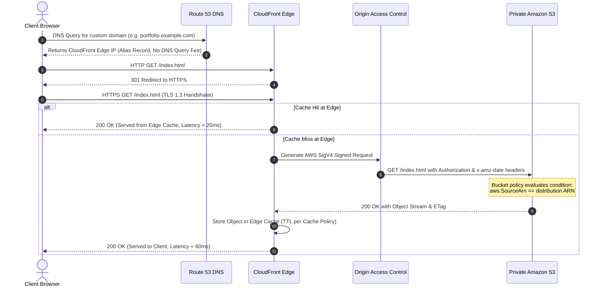

# Architecture Specification
## Secure and Globally Distributed Static Website Hosting Using AWS S3, CloudFront and Route 53

---

## 1. Executive Summary

This document specifies the technical architecture for hosting a high-performance, strictly secured, and globally distributed static website using native Amazon Web Services (AWS) managed infrastructure. 

The architecture adheres to AWS Well-Architected Framework best practices, completely eliminating server management overhead (no EC2, Docker, Kubernetes, Lambda, or database instances) while delivering sub-50ms latency across global edge locations with zero-trust origin protection.

---

## 2. High-Level Architecture Diagram

```mermaid
flowchart TD
    User["🌐 End User Browser"]
    
    subgraph Route53_Layer["DNS Layer (Amazon Route 53)"]
        R53["Route 53 Hosted Zone\nAlias Record (A) -> CloudFront\nLatency-based Anycast Routing"]
    end

    subgraph CloudFront_Layer["Edge CDN Layer (Amazon CloudFront)"]
        Edge["400+ Edge Locations (PoPs)\nTLS 1.2/1.3 Termination\nCachingOptimized Cache Policy\nHTTP-to-HTTPS Auto-Redirect"]
        ACM["AWS Certificate Manager (ACM)\nPublic SSL/TLS Certificate\n(Deployed in us-east-1)"]
        ACM -.-> Edge
    end

    subgraph Security_Boundary["Security Boundary (Origin Access Control)"]
        OAC["CloudFront OAC\nSigV4 Request Signing\nZero-Trust Identity"]
    end

    subgraph Storage_Layer["Private Storage Layer (Amazon S3)"]
        S3["Amazon S3 Static Bucket\n🔒 Block Public Access: 100% ENABLED\n🛡️ Bucket Policy: aws:SourceArn Condition\nRelative Objects: index.html, assets/"]
    end

    PublicInternet["❌ Direct Internet Access"] -.->|Blocked: 403 Forbidden| S3

    User -->|1. DNS Query| R53
    R53 -->|2. Resolves CloudFront Anycast IP| User
    User -->|3. HTTPS Request (Port 443)| Edge
    Edge -->|4. Authenticated Request (SigV4)| OAC
    OAC -->|5. Authorized Read Only| S3
    S3 -->|6. Static Asset Payload| Edge
    Edge -->|7. Fast Cached Delivery| User
```

---

## 3. End-to-End Traffic Flow & Request Lifecycle



---

## 4. Architectural Component Breakdown

### 4.1. Amazon S3 (Origin Storage Layer)
* **Purpose**: Durable, scalable object storage for all website static artifacts (`index.html`, `assets/css/style.css`, `assets/js/script.js`, `assets/images/*`).
* **Configuration**:
  * **S3 Static Website Hosting**: **DISABLED**. The bucket is treated as a standard private REST object store.
  * **S3 Block Public Access**: **100% ENABLED** across all four parameters:
    * `BlockPublicAcls = true`
    * `IgnorePublicAcls = true`
    * `BlockPublicPolicy = true`
    * `RestrictPublicBuckets = true`
  * **Default Encryption**: Server-Side Encryption with Amazon S3 managed keys (SSE-S3) or AWS KMS (SSE-KMS).
  * **Bucket Policy**: Grants read permissions (`s3:GetObject`) exclusively to the CloudFront service principal (`cloudfront.amazonaws.com`) scoped to the specific distribution ARN using the `AWS:SourceArn` condition.

### 4.2. Amazon CloudFront (Content Delivery Network & Edge Security)
* **Purpose**: Global low-latency caching, SSL/TLS termination, and DDoS mitigation.
* **Configuration**:
  * **Origin Domain**: Points to the S3 REST endpoint (`<bucket-name>.s3.<region>.amazonaws.com`).
  * **Origin Access**: Configured with **Origin Access Control (OAC)**.
  * **Default Root Object**: Set to `index.html`.
  * **Viewer Protocol Policy**: `Redirect HTTP to HTTPS`.
  * **Allowed HTTP Methods**: `GET, HEAD` (Read-only static workload).
  * **Cache Policy**: `Managed-CachingOptimized` (Cache Policy ID: `658327ea-f89d-4fab-a63d-7e88639e58f6`):
    * Gzip and Brotli compression enabled automatically.
    * Respects standard HTTP caching headers (`Cache-Control`, `ETag`).

### 4.3. CloudFront Origin Access Control (OAC)
* **Purpose**: Modern, secure identity mechanism for authenticating CloudFront requests to private S3 origins.
* **Why OAC Replaces Legacy OAI (Origin Access Identity)**:
  1. **AWS Signature Version 4 (SigV4)**: OAC signs origin requests using SigV4, ensuring cryptographically verifiable requests.
  2. **SSE-KMS Encryption Support**: OAC seamlessly supports S3 buckets encrypted with customer-managed KMS keys (which OAI could not support).
  3. **Global Region Compatibility**: OAC supports all AWS regions, including opt-in regions launched after 2019.
  4. **Granular Least Privilege**: OAC enforces strict policy scoping via `AWS:SourceArn` in the S3 bucket policy.

### 4.4. Amazon Route 53 (DNS Layer — Optional / Custom Domain)
* **Purpose**: Highly available and fault-tolerant Domain Name System (DNS) service.
* **Configuration**:
  * **Hosted Zone**: Public hosted zone for the registered custom domain.
  * **Alias Record**: Route 53 `A` and `AAAA` (IPv6) Alias records pointing directly to the CloudFront distribution domain (`dxxxxxxxxxxxxx.cloudfront.net`).
  * **Zero Query Cost**: AWS does not charge for Route 53 DNS queries targeting CloudFront distributions.

### 4.5. AWS Certificate Manager (ACM) (TLS/SSL Layer)
* **Purpose**: Automated provisioning and renewal of free public SSL/TLS certificates.
* **Configuration**:
  * **Region Requirement**: Public certificates for CloudFront distributions **must** be requested in the `us-east-1` (N. Virginia) region.
  * **Validation Method**: DNS validation via Route 53 CNAME record.
  * **Minimum Security Standard**: Enforces TLS 1.2 or TLS 1.3 protocol versions (`TLSv1.2_2021` security policy).

---

## 5. Performance and Caching Strategy

| Layer | Cache Setting / Policy | Cache TTL (Default / Max) | Invalidation Trigger |
| :--- | :--- | :--- | :--- |
| **HTML (`index.html`)** | `Cache-Control: public, max-age=0, must-revalidate` | 0 seconds (Edge revalidates with ETag) | Automatic on code deployment (`/*`) |
| **CSS & JS (`assets/*`)** | `Cache-Control: public, max-age=31536000, immutable` | 1 Year (Cached at edge & browser) | Cache-busting via deployment invalidation |
| **Images & SVGs** | `Cache-Control: public, max-age=2592000` | 30 Days (Edge cached) | Invalidation on asset update |

---

## 6. Failure Modes and Resilience

1. **S3 Regional Outage**: CloudFront edge caches continue serving cached objects from Point of Presence (PoP) locations even during transient origin unavailability.
2. **DDoS & Traffic Spikes**: AWS Shield Standard automatically protects Route 53 and CloudFront edge servers against SYN floods, UDP reflection attacks, and Layer 3/4 volumetric spikes.
3. **Data Tampering**: Because S3 write access is blocked and CloudFront only issues `GET/HEAD` requests signed via OAC, no public actor can modify or inject scripts into the storage bucket.
