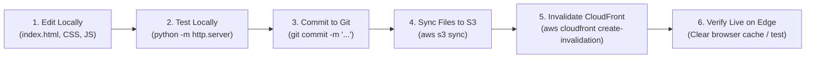

# AWS Deployment Guide
## Secure Static Website Hosting (Amazon S3 + CloudFront OAC + Route 53 + ACM)

This guide provides step-by-step instructions to deploy the static website to AWS using either the **AWS Management Console** or the **AWS CLI**. 

> [!IMPORTANT]
> **AWS Security Rules**:
> * Never hardcode or commit AWS credentials, access keys, or secret keys.
> * Keep the S3 bucket **strictly private** (`Block Public Access` enabled).
> * Never use S3 Static Website Hosting mode when using CloudFront with OAC; use the standard private S3 REST endpoint.
> * Replace all placeholders (`<your-bucket-name>`, `<your-aws-account-id>`, `<your-distribution-id>`, `<your-domain.com>`) with your real AWS values.

---

## Prerequisites Checklist

1. An active [AWS Account](https://aws.amazon.com/).
2. An IAM user or role with least-privilege administrative access to S3, CloudFront, Route 53, and ACM.
3. (Optional) A registered domain name if you plan to configure Route 53 and custom SSL.
4. AWS CLI installed and configured locally (`aws configure`) if using terminal deployment.

---

## Phase 1: Create the Private Amazon S3 Origin Bucket

### Step 1.1: Create the S3 Bucket
1. Open the **Amazon S3 Console** at [https://console.aws.amazon.com/s3/](https://console.aws.amazon.com/s3/).
2. Click **Create bucket**.
3. Configure the bucket parameters:
   * **Bucket name**: Choose a globally unique name in lowercase (e.g., `portfolio-static-web-<your-unique-id>`).
   * **AWS Region**: Select your preferred region (e.g., `us-east-1` or `ap-south-1`).
   * **Object Ownership**: Leave as **ACLs disabled (recommended)**.
   * **Block Public Access settings for this bucket**:
     * Keep **Block *all* public access** checked (100% enabled).
     * Do **NOT** uncheck this box.
   * **Bucket Versioning**: Optional (Recommended: *Enable* for version rollbacks).
   * **Default encryption**: *Server-side encryption with Amazon S3 managed keys (SSE-S3)*.
4. Click **Create bucket**.

*Alternative CLI Command:*
```bash
# Set your variables
export BUCKET_NAME="<your-bucket-name>"
export REGION="<your-region>"

# Create private S3 bucket
aws s3api create-bucket \
  --bucket "$BUCKET_NAME" \
  --region "$REGION" \
  --create-bucket-configuration LocationConstraint="$REGION" # (Omit LocationConstraint if region is us-east-1)

# Ensure Block Public Access is 100% enabled
aws s3api put-public-access-block \
  --bucket "$BUCKET_NAME" \
  --public-access-block-configuration "BlockPublicAcls=true,IgnorePublicAcls=true,BlockPublicPolicy=true,RestrictPublicBuckets=true"
```

---

### Step 1.2: Upload Website Files to S3
Upload the website files while preserving the exact directory structure:

1. In the S3 Console, click on your newly created bucket.
2. Click **Upload** $\rightarrow$ **Add files** $\rightarrow$ Select `index.html`.
3. Click **Add folder** $\rightarrow$ Select the entire `assets/` folder (containing `css/`, `js/`, and `images/`).
4. Verify the uploaded structure inside the bucket:
   ```text
   <your-bucket-name>/
   ├── index.html
   └── assets/
       ├── css/style.css
       ├── js/script.js
       └── images/
           ├── favicon.svg
           ├── avatar-placeholder.svg
           ├── aws-architecture-diagram.svg
           ├── project-aws-showcase.svg
           ├── project-cloud-security.svg
           ├── project-data-analytics.svg
           └── project-web-platform.svg
   ```
5. Click **Upload**.

*Alternative CLI Command:*
```bash
# Run from the project root directory
aws s3 sync . s3://"$BUCKET_NAME"/ \
  --exclude ".git/*" \
  --exclude ".github/*" \
  --exclude "client/*" \
  --exclude "server/*" \
  --exclude "docs/*" \
  --exclude "README*.md" \
  --exclude "*.ps1" \
  --exclude "*.json" \
  --exclude ".gitignore" \
  --exclude "spec.md" \
  --exclude "encrypt*"
```

---

## Phase 2: Create the Amazon CloudFront Distribution with OAC

### Step 2.1: Create Origin Access Control (OAC)
1. Open the **Amazon CloudFront Console** at [https://console.aws.amazon.com/cloudfront/](https://console.aws.amazon.com/cloudfront/).
2. In the left navigation pane, under **Security**, choose **Origin access**.
3. Click **Create control setting**:
   * **Name**: `OAC-S3-Portfolio`
   * **Description**: `Origin Access Control for Private Portfolio S3 Bucket`
   * **Signing protocol**: `SigV4 (recommended)`
   * **Origin type**: `S3`
   * **Signing behavior**: `Sign requests (recommended)`
4. Click **Create**.

---

### Step 2.2: Configure and Launch CloudFront Distribution
1. In the CloudFront console, select **Distributions** $\rightarrow$ Click **Create distribution**.
2. **Origin settings**:
   * **Origin domain**: Select your S3 bucket from the dropdown (e.g., `<your-bucket-name>.s3.<region>.amazonaws.com`).
     > [!WARNING]
     > Do **NOT** use the S3 Static Website Endpoint. Use the standard S3 REST bucket endpoint.
   * **Origin access**: Select **Origin access control settings (recommended)**.
   * **Origin access control**: Choose the `OAC-S3-Portfolio` control setting created in Step 2.1.
3. **Default cache behavior**:
   * **Viewer protocol policy**: Select **Redirect HTTP to HTTPS**.
   * **Allowed HTTP methods**: Select **GET, HEAD**.
   * **Restrict viewer access**: No.
   * **Cache key and origin requests**: Choose **Cache policy and origin request policy (recommended)**.
     * **Cache policy**: Select **CachingOptimized**.
4. **Function associations**: Leave blank.
5. **Settings**:
   * **Price class**: Choose *Use all edge locations (best performance)* or *Use only North America and Europe*.
   * **Alternate domain name (CNAME)**: Leave empty for now (configured in Phase 4 if you have a custom domain).
   * **Custom SSL certificate**: Default CloudFront certificate (`*.cloudfront.net`).
   * **Default root object**: Enter **`index.html`** (Critical!).
6. Click **Create distribution**.
7. Note down your **Distribution ID** (e.g., `E1234567890ABC`) and **Distribution domain name** (e.g., `d111111abcdef8.cloudfront.net`).

---

## Phase 3: Apply the S3 Bucket Policy for CloudFront OAC

The CloudFront console will show a banner prompt: *"You must update the S3 bucket policy to grant CloudFront read permission."*

1. Copy the bucket policy template below, replacing the three bracketed values:
   * `<your-bucket-name>`: Name of your S3 bucket.
   * `<your-aws-account-id>`: Your 12-digit AWS Account ID (without dashes).
   * `<your-distribution-id>`: Your CloudFront Distribution ID.

```json
{
  "Version": "2012-10-17",
  "Statement": [
    {
      "Sid": "AllowCloudFrontServicePrincipalReadOnly",
      "Effect": "Allow",
      "Principal": {
        "Service": "cloudfront.amazonaws.com"
      },
      "Action": "s3:GetObject",
      "Resource": "arn:aws:s3:::<your-bucket-name>/*",
      "Condition": {
        "StringEquals": {
          "AWS:SourceArn": "arn:aws:cloudfront::<your-aws-account-id>:distribution/<your-distribution-id>"
        }
      }
    }
  ]
}
```

2. Open the **Amazon S3 Console** $\rightarrow$ Click on your bucket $\rightarrow$ Select the **Permissions** tab.
3. Scroll to **Bucket policy** $\rightarrow$ Click **Edit**.
4. Paste the JSON policy and click **Save changes**.

---

### Step 3.1: Verification of CloudFront & S3 Isolation
1. **Direct S3 Access Test (Must Fail)**:
   * Open your browser and navigate to: `https://<your-bucket-name>.s3.<region>.amazonaws.com/index.html`.
   * **Expected Result**: `403 Forbidden` (`AccessDenied`).
   * **Why**: Direct internet access is blocked by S3 Block Public Access and least-privilege bucket policy.
2. **CloudFront Access Test (Must Succeed)**:
   * Wait 2–3 minutes for the distribution status to change from *Deploying* to *Enabled*.
   * Navigate to: `https://<your-distribution-id>.cloudfront.net`.
   * **Expected Result**: The website loads completely over HTTPS with all CSS, JS, and vector images rendered perfectly.

---

## Phase 4: Configure Route 53 & ACM Custom Domain (Optional)

If you have a custom domain (e.g., `portfolio.example.com`), complete this phase:

### Step 4.1: Request Public Certificate in AWS Certificate Manager (ACM)
1. Open the **AWS Certificate Manager Console** at [https://console.aws.amazon.com/acm/](https://console.aws.amazon.com/acm/).
2. **CRITICAL**: Switch your AWS Console Region to **US East (N. Virginia) `us-east-1`**. CloudFront only accepts public certificates stored in `us-east-1`.
3. Click **Request a certificate** $\rightarrow$ Choose **Request a public certificate**.
4. Enter your fully qualified domain name (e.g., `portfolio.example.com` or `*.example.com`).
5. Choose **DNS validation (recommended)**.
6. Click **Request**.
7. In the certificate details screen, click **Create records in Route 53** to automatically populate the required CNAME validation record in your hosted zone.
8. Wait a few minutes until the certificate status displays **Issued**.

---

### Step 4.2: Attach Custom Domain to CloudFront
1. Open your CloudFront distribution $\rightarrow$ In the **General** tab, click **Edit**.
2. Under **Alternate domain name (CNAME)**, click **Add item** and enter your domain (e.g., `portfolio.example.com`).
3. Under **Custom SSL certificate**, select the ACM certificate issued in Step 4.1.
4. Leave **Security policy** as `TLSv1.2_2021 (recommended)`.
5. Click **Save changes**.

---

### Step 4.3: Create Route 53 Alias Record
1. Open the **Amazon Route 53 Console** at [https://console.aws.amazon.com/route53/](https://console.aws.amazon.com/route53/).
2. Click **Hosted zones** $\rightarrow$ Select your domain's hosted zone.
3. Click **Create record**:
   * **Record name**: Subdomain prefix (e.g., `portfolio` or leave empty for root domain).
   * **Record type**: **A — Routes traffic to an IPv4 address and some AWS resources**.
   * Toggle **Alias** to **ON**.
   * **Route traffic to**:
     * Select **Alias to CloudFront distribution**.
     * Choose your CloudFront distribution domain name from the dropdown (`dxxxxxxxxxxxxx.cloudfront.net`).
   * **Routing policy**: Simple routing.
   * **Evaluate target health**: No.
4. Click **Create records**.
5. Test your custom domain over HTTPS in your browser (`https://portfolio.example.com`).

---

## Phase 5: Ongoing Content Update Workflow

When you update HTML, CSS, JavaScript, or images in your local development environment:



### Command Sequence for Content Updates:
```bash
# 1. Sync updated files to S3
aws s3 sync . s3://<your-bucket-name>/ \
  --exclude ".git/*" --exclude "docs/*" --exclude "README*.md"

# 2. Invalidate CloudFront edge cache so changes appear immediately
aws cloudfront create-invalidation \
  --distribution-id <your-distribution-id> \
  --paths "/*"
```

---

## Phase 6: Troubleshooting Guide

| Issue | Root Cause | Solution |
| :--- | :--- | :--- |
| **403 Forbidden** on CloudFront URL | Missing or invalid S3 bucket policy condition. | Verify bucket policy has `aws:SourceArn: arn:aws:cloudfront::<account-id>:distribution/<dist-id>`. Ensure bucket name and distribution ID match exactly. |
| **403 Forbidden** on direct S3 URL | Expected behavior! | S3 is private by design. Do NOT make the bucket public. Access must occur exclusively through CloudFront. |
| **Root URL (`/`) returns AccessDenied / 404** | Missing Default Root Object. | In CloudFront Settings, set **Default root object** to `index.html`. |
| **CSS/JS/Images Not Loading (404)** | Absolute filesystem paths or incorrect S3 folder structure. | Verify all HTML asset links use relative paths (`assets/css/style.css`). Check that the `assets/` directory was uploaded preserving structure. |
| **Old Version Persists After Update** | CloudFront Edge Cache TTL is still active. | Run a CloudFront cache invalidation for `/*`. In browser, perform hard refresh (`Ctrl + Shift + R`). |
| **Custom Domain SSL Error** | Certificate not in `us-east-1` or CNAME mismatch. | Public certificates for CloudFront **must** be created in `us-east-1` (N. Virginia). Ensure Alternate Domain Names in CloudFront match the certificate domain. |
