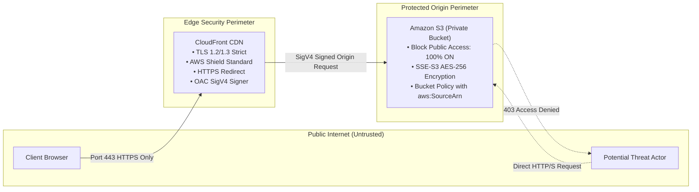

# Security Architecture & Hardening Guide
## Zero-Trust Origin Isolation with AWS S3, CloudFront OAC, and TLS Encryption

---

## 1. Security Architecture Overview

This project implements a **Zero-Trust Defense-in-Depth** model for static website delivery. The origin storage (Amazon S3) is completely hidden from the public internet, accessible only through authenticated, cryptographically signed requests originating from a designated Amazon CloudFront distribution.



---

## 2. Deep Dive: Origin Access Control (OAC) vs. Legacy OAI

AWS previously used **Origin Access Identity (OAI)** to restrict access to S3 buckets. In August 2022, AWS released **Origin Access Control (OAC)**, which is the current recommended standard and best practice.

### Architectural Comparison Table

| Feature / Dimension | Legacy OAI (Origin Access Identity) | Modern OAC (Origin Access Control) | Security Impact in This Project |
| :--- | :--- | :--- | :--- |
| **Authentication Protocol** | Custom AWS identity header | **AWS Signature Version 4 (SigV4)** | Cryptographically verified origin requests preventing request tampering. |
| **SSE-KMS Encryption** | ❌ Unsupported | **✅ Fully Supported** | Enables customer-managed KMS encryption keys for enterprise compliance. |
| **Regional Availability** | Limited (fails on opt-in regions post-2019) | **✅ All Global AWS Regions** | Consistent deployment across all commercial and gov cloud regions. |
| **HTTP Methods** | `GET, HEAD` only | **✅ `GET, HEAD, PUT, POST, PATCH, DELETE`** | Flexible security model supporting advanced workflows. |
| **Policy Granularity** | Principal-based (`AWS: arn:aws:iam::cloudfront:user/OAI...`) | **Service Principal + `AWS:SourceArn` Condition** | True least-privilege scoping; prevents "Confused Deputy" attacks across distributions. |

---

## 3. Amazon S3 Block Public Access Hardening

Amazon S3 Block Public Access is **100% enabled** on the origin bucket. This provides a centralized control plane guardrail that overrides any accidental public ACLs or policies.

```json
{
  "BlockPublicAcls": true,
  "IgnorePublicAcls": true,
  "BlockPublicPolicy": true,
  "RestrictPublicBuckets": true
}
```

### Breakdown of the 4 Security Flags:
1. **`BlockPublicAcls = true`**: Rejects any future `PUT Bucket acl` or `PUT Object acl` requests that attempt to grant public read access.
2. **`IgnorePublicAcls = true`**: Causes S3 to ignore all existing public ACLs on bucket objects, rendering any public ACL ineffective.
3. **`BlockPublicPolicy = true`**: Rejects any bucket policy update that would permit unauthenticated public access.
4. **`RestrictPublicBuckets = true`**: Restricts access to the bucket strictly to AWS service principals and authorized IAM entities, blocking public or cross-account access.

---

## 4. Least-Privilege S3 Bucket Policy Analysis

The origin bucket policy is crafted to enforce the exact principle of least privilege:

```json
{
  "Version": "2012-10-17",
  "Statement": [
    {
      "Sid": "AllowCloudFrontServicePrincipalReadOnly",
      "Effect": "Allow",
      "Principal": {
        "Service": "cloudfront.amazonaws.com"
      },
      "Action": "s3:GetObject",
      "Resource": "arn:aws:s3:::<your-bucket-name>/*",
      "Condition": {
        "StringEquals": {
          "AWS:SourceArn": "arn:aws:cloudfront::<your-aws-account-id>:distribution/<your-distribution-id>"
        }
      }
    }
  ]
}
```

### Security Policy Audit Points:
* **Principal Scoping**: Specifies `cloudfront.amazonaws.com` rather than a generic wildcard (`*`).
* **Action Scoping**: Restricted strictly to `s3:GetObject`. It grants zero permissions for `s3:PutObject`, `s3:DeleteObject`, or `s3:ListBucket`.
* **Resource Scoping**: Scoped to objects inside the bucket (`arn:aws:s3:::<your-bucket-name>/*`), preventing metadata leakage on the bucket root.
* **Condition Scoping (`AWS:SourceArn`)**: This is the critical zero-trust constraint. It guarantees that **only** the designated CloudFront distribution in your specific AWS Account ID can read objects. Even if another AWS customer creates a CloudFront distribution pointing at your bucket name, S3 will reject their requests.

---

## 5. Transport Layer Security (TLS/HTTPS) Enforcements

1. **Viewer Protocol Policy**: Configured to `Redirect HTTP to HTTPS`. Any unencrypted port 80 request is automatically issued an HTTP 301 redirect to port 443 HTTPS.
2. **Minimum SSL/TLS Protocol Version**: Configured with `TLSv1.2_2021` or higher. Legacy, vulnerable protocols (SSLv3, TLS 1.0, TLS 1.1) and weak RC4/DES ciphers are disabled at the edge.
3. **Automated Certificate Validation**: AWS Certificate Manager (ACM) provisions certificates with 2048-bit RSA or ECDSA keys and manages automatic renewal before expiration.

---

## 6. Zero Credential Exposure Protocol

In accordance with strict security standards:
* **No Access Keys or Secrets**: No AWS access key ID, secret access key, or session token is stored anywhere in the repository, frontend HTML, CSS, or JavaScript.
* **Client-Side Form Safety**: The contact form does not connect to unauthenticated APIs or simulate fake backends. Form submission initiates via client-side validation and secure `mailto:` delegation.
* **Git Exclusions**: The project's `.gitignore` explicitly filters credentials, `.env` files, `.pem` private keys, and Cloud provider configurations.

---

## 7. Threat Modeling & Risk Mitigation Matrix

| Threat Category | Potential Attack Vector | Applied Mitigation in This Architecture |
| :--- | :--- | :--- |
| **Origin Exposure & Data Scraping** | Malicious crawler scraping S3 bucket directly to bypass CDN rate limits or inspect internal structure. | S3 Block Public Access is ON. Direct requests return `403 Forbidden`. Only OAC-signed requests succeed. |
| **Confused Deputy Attack** | A compromised or third-party CloudFront distribution attempting to route requests to your private S3 bucket. | S3 Bucket Policy condition enforces `StringEquals: AWS:SourceArn` matching your specific distribution ARN and account ID. |
| **Man-in-the-Middle (MITM)** | Interception or modification of plaintext HTTP traffic between user and website. | CloudFront terminates TLS 1.2/1.3 and enforces automatic HTTP-to-HTTPS redirect. |
| **Volumetric DDoS Attacks** | Flooding web server infrastructure with Layer 3/4 volumetric traffic. | Edge traffic absorbed by AWS Global Network and AWS Shield Standard across 400+ PoPs without hitting origin storage. |
| **Data Tampering & Ransomware** | Unauthorized actor writing or deleting static assets on origin storage. | S3 bucket policy is strictly read-only (`s3:GetObject`). All write actions (`s3:PutObject`, `s3:DeleteObject`) require authenticated IAM credentials. |
| **Credential Leakage via Source Code** | Developer accidentally pushing AWS secret keys to GitHub. | Static site architecture requires zero IAM credentials in code. Pre-commit `.gitignore` guards all credential file patterns. |
